# UML Architecture and Design Diagrams

This document provides a complete set of Unified Modeling Language (UML) diagrams for the Movie Ticket Booking system. It details the system's structural components, runtime object models, behavioral interactions, concurrency models, and state transitions.

---

## 1. System Use Case Diagram

The use case diagram illustrates the actors interacting with the system and the core capabilities provided by the [`cinema::BookingService`](include/cinema/booking_service.hpp:38) backend and [`cinema::runCli`](include/cinema/cli.hpp:29) interface.

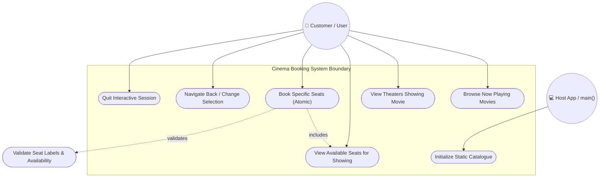

---

## 2. Package and Component Diagram

This diagram shows the modular structure, headers, compilation units, static library dependencies, and executables built via CMake.

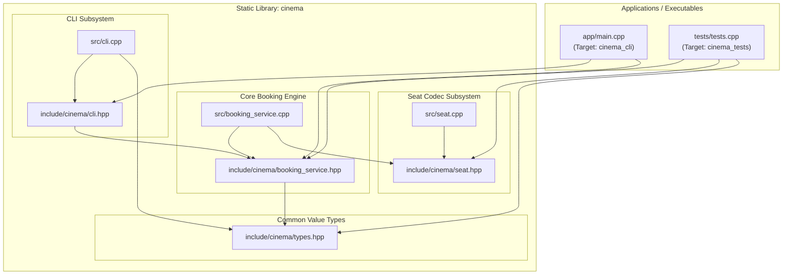

---

## 3. Class Diagram: Public API and Domain Model

This diagram documents the public data structures, enumerations, classes, and relationships exposed by [`include/cinema/types.hpp`](include/cinema/types.hpp:14), [`include/cinema/seat.hpp`](include/cinema/seat.hpp:19), and [`include/cinema/booking_service.hpp`](include/cinema/booking_service.hpp:28).

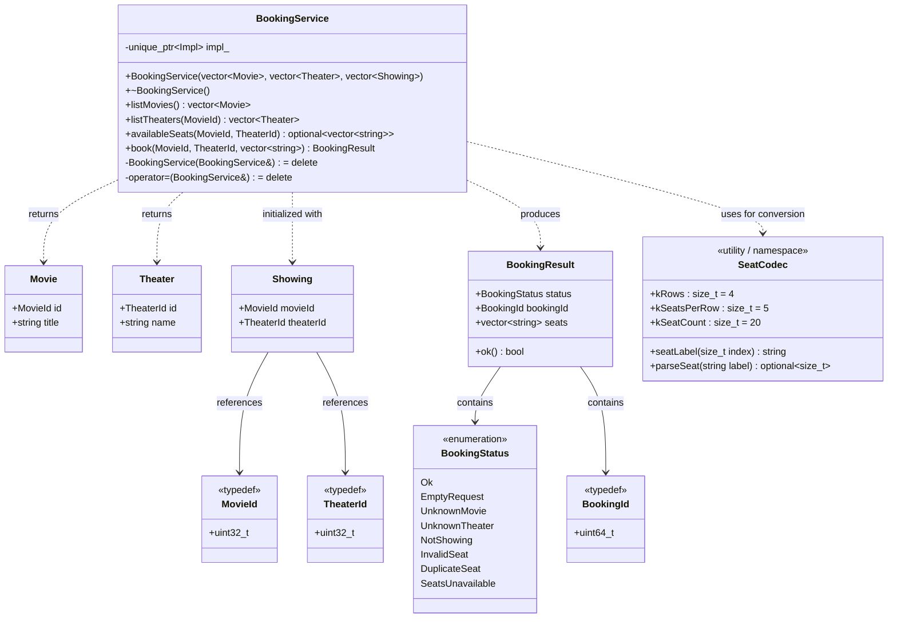

---

## 4. Detailed Design Class Diagram (PIMPL & Concurrency Internals)

This diagram details the internal compilation-firewall implementation (`BookingService::Impl`), private data structures, container types, and fine-grained mutex synchronization.

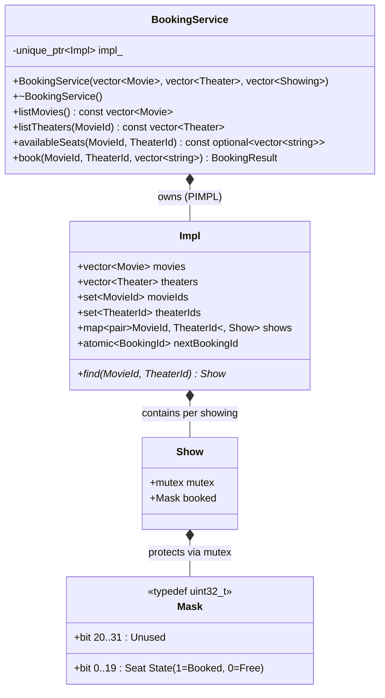

---

## 5. Object Diagram (Runtime Instance Snapshot)

This diagram visualizes a concrete runtime instance snapshot initialized by [`app/main.cpp`](app/main.cpp:8) with 3 movies, 3 theaters, and 5 showings.

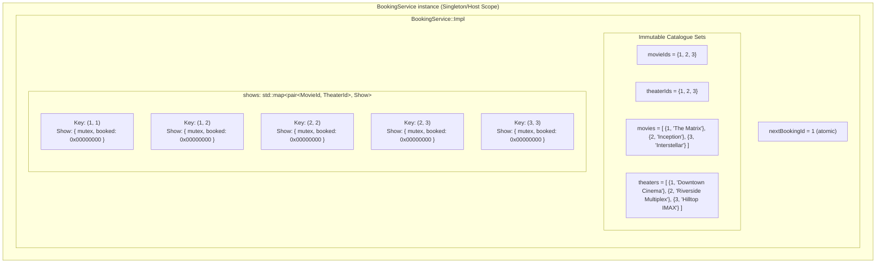

---

## 6. Sequence Diagrams

### 6.1. Successful Seat Booking Flow

Demonstrates the execution path for [`BookingService::book()`](src/booking_service.cpp:121) from customer CLI input to atomic bitmask commit and receipt generation.

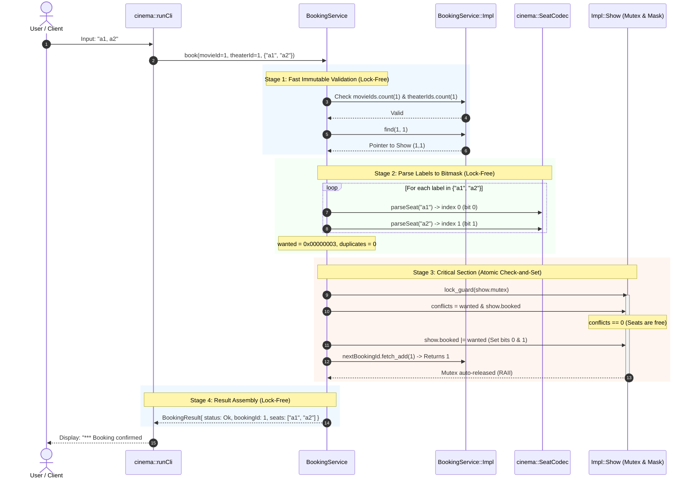

---

### 6.2. Concurrent Booking Contention (Thread Race Condition)

Illustrates how two concurrent threads attempting to book overlapping seats for the same showing are synchronized via [`std::mutex`](src/booking_service.cpp:175), ensuring zero over-booking.

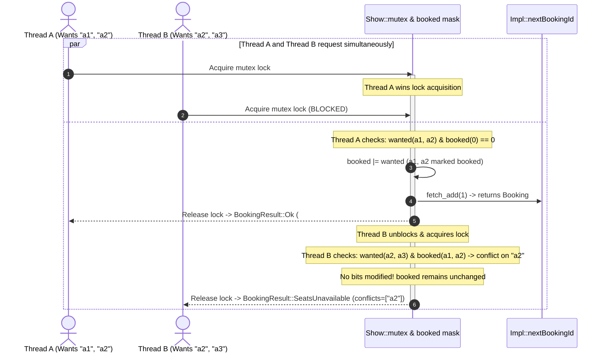

---

### 6.3. Information Query Sequence (Movies, Theaters, Available Seats)

Shows how clients query movies, venues, and layout seat availability without holding broad locks.

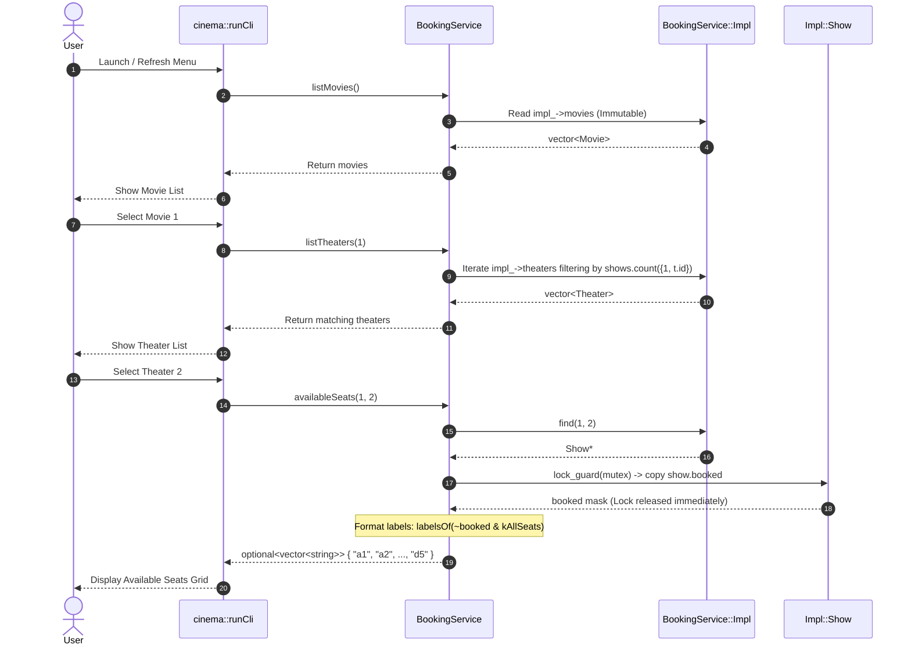

---

## 7. Activity Diagrams / Flowcharts

### 7.1. Booking Validation Pipeline & Atomic Execution

Details the exact step-by-step decision tree implemented in [`BookingService::book()`](src/booking_service.cpp:121).

```mermaid
flowchart TD
    Start([Call BookingService::book]) --> CheckEmpty{seats.empty?}
    
    CheckEmpty -- Yes --> RetEmpty[Return BookingStatus::EmptyRequest]
    CheckEmpty -- No --> CheckMovie{movieIds.count(movie)?}
    
    CheckMovie -- No --> RetMovie[Return BookingStatus::UnknownMovie]
    CheckMovie -- Yes --> CheckTheater{theaterIds.count(theater)?}
    
    CheckTheater -- No --> RetTheater[Return BookingStatus::UnknownTheater]
    CheckTheater -- Yes --> CheckShowing{find(movie, theater) != nullptr?}
    
    CheckShowing -- No --> RetNotShowing[Return BookingStatus::NotShowing]
    CheckShowing -- Yes --> ParseSeats[Parse and Validate Seat Labels]

    ParseSeats --> CheckMalformed{Any parse errors?}
    CheckMalformed -- Yes --> RetInvalid[Return BookingStatus::InvalidSeat\nwith malformed strings]
    CheckMalformed -- No --> CheckDuplicates{duplicates != 0?}

    CheckDuplicates -- Yes --> RetDup[Return BookingStatus::DuplicateSeat\nwith duplicated labels]
    CheckDuplicates -- No --> PrepAlloc[Allocate wantedLabels vector\nSafe from bad_alloc]

    PrepAlloc --> AcquireLock[Acquire Show::mutex Lock]
    AcquireLock --> CheckConflict{wanted & show.booked != 0?}

    CheckConflict -- Yes --> ReleaseLockFail[Release Lock]
    ReleaseLockFail --> RetUnavailable[Return BookingStatus::SeatsUnavailable\nwith conflicting labels]

    CheckConflict -- No --> Commit[show.booked |= wanted\nid = nextBookingId++]
    Commit --> ReleaseLockSuccess[Release Lock]
    ReleaseLockSuccess --> RetOk[Return BookingStatus::Ok\nwith bookingId & seats]

    RetEmpty --> End([End])
    RetMovie --> End
    RetTheater --> End
    RetNotShowing --> End
    RetInvalid --> End
    RetDup --> End
    RetUnavailable --> End
    RetOk --> End
```

---

### 7.2. CLI Interactive Navigation Flow

Illustrates the menu navigation lifecycle in [`cinema::runCli()`](src/cli.cpp:40).

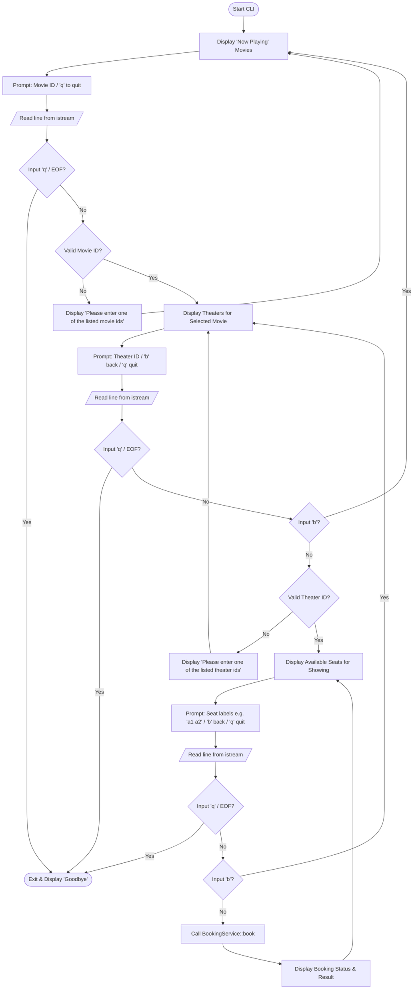

---

## 8. State Machine Diagrams

### 8.1. Seat Lifecycle State Machine

Represents the state of an individual seat bit within a specific [`Showing`](include/cinema/types.hpp:36).

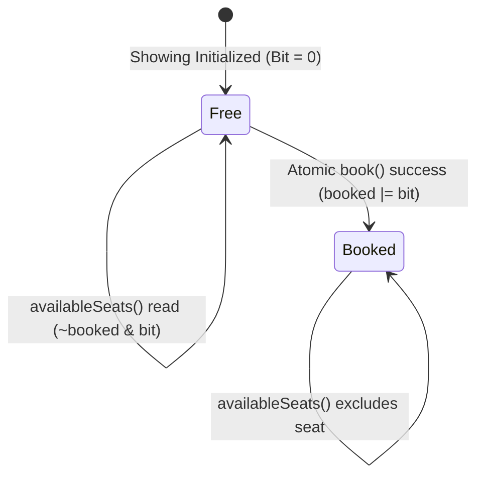

---

### 8.2. CLI Navigation State Machine

Models the finite state machine transitions of the user interface level ([`enum Level`](src/cli.cpp:41)).

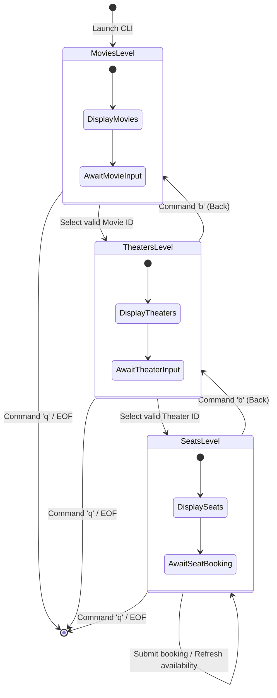

---

## 9. Deployment and Concurrency Architecture Diagram

Visualizes the process memory structure, execution threads, thread safety boundaries, and OS stream interfaces.

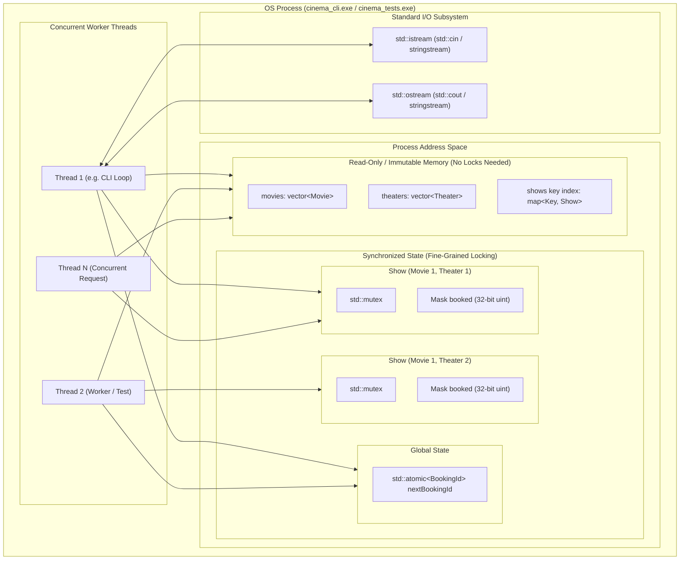
